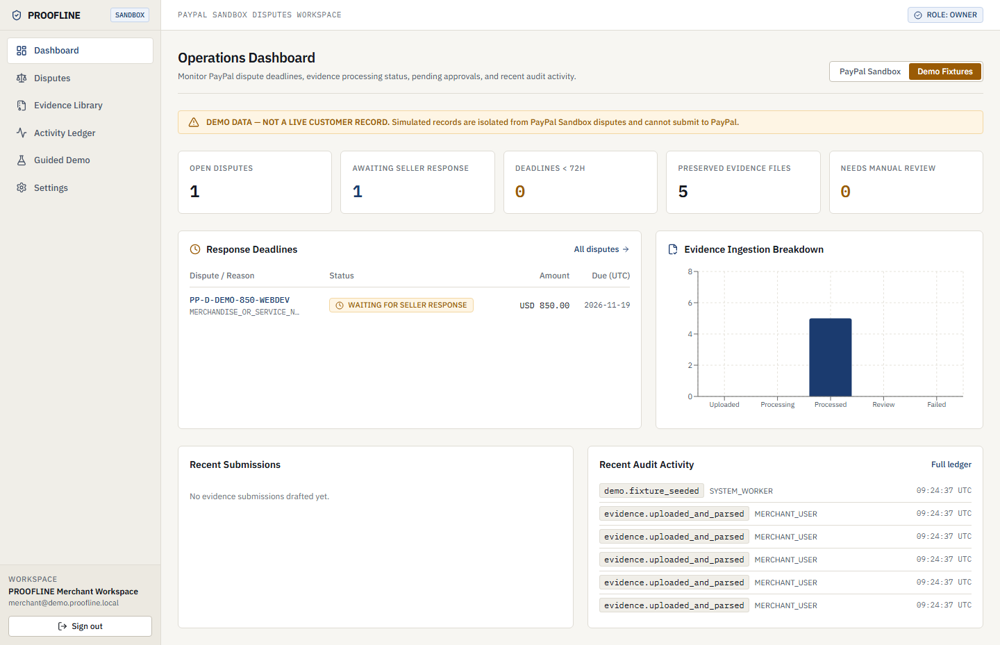
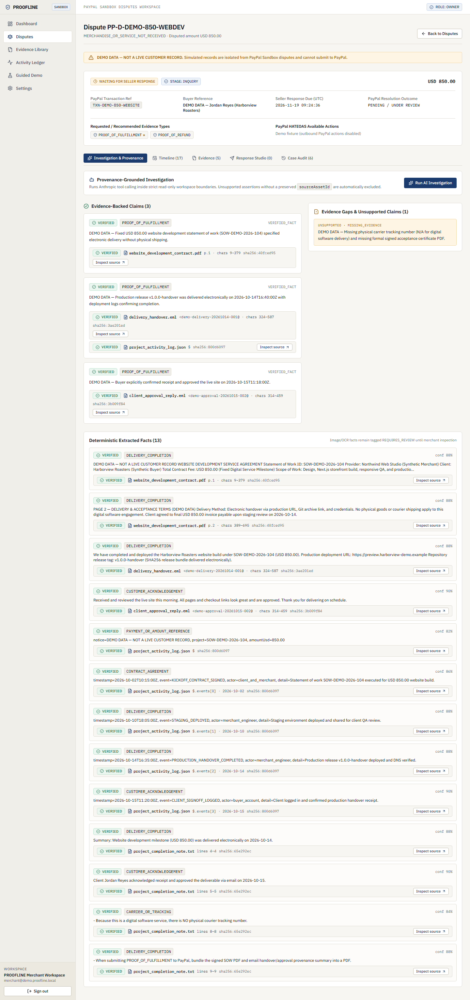
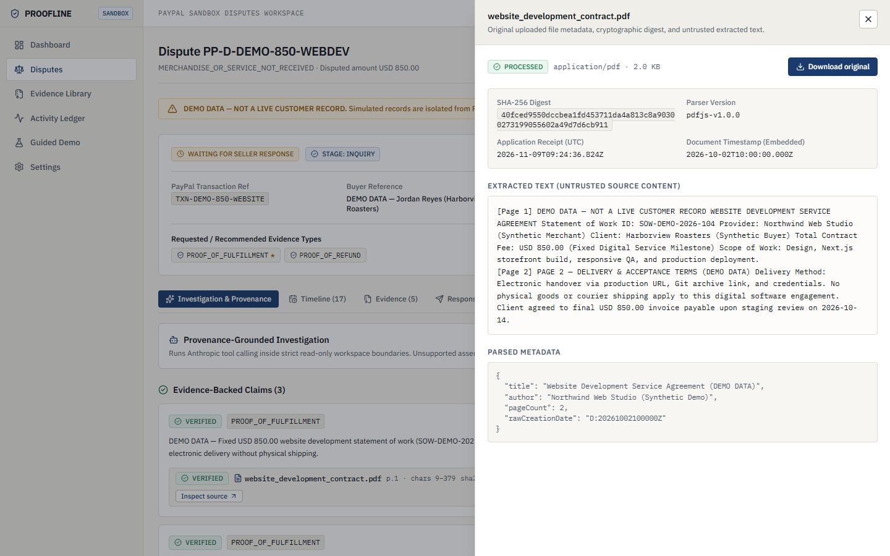
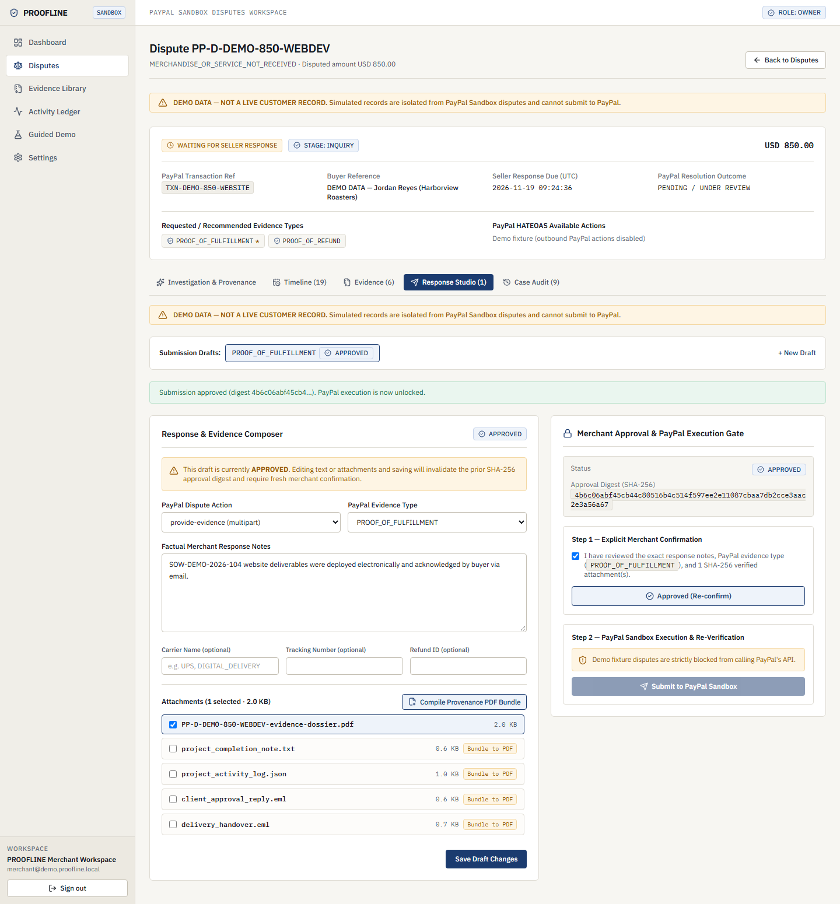

# PROOFLINE

**Evidence you can trace. Disputes you can defend.**

PROOFLINE is an AI-assisted PayPal dispute investigation and evidence preparation platform built for freelancers, independent software developers, creative agencies, and small digital service businesses.

Instead of acting as a black-box chatbot or generic chargeback dashboard, PROOFLINE enforces **end-to-end evidence provenance**: uploaded files are cryptographically hashed with SHA-256, preserved privately, parsed deterministically into typed `SourceLocator` coordinates, isolated against prompt injection, verified before any AI factual claim is accepted, and assembled into PayPal-ready PDF dossiers only after explicit merchant approval.

---

## Core Guarantees

1. **Verifiable Source Provenance**: Every extracted fact and AI-supported claim cites an immutable workspace `sourceAssetId`, SHA-256 checksum, and typed `SourceLocator` (`pdf_page`, `email_message`, `csv_row`, `json_path`, `text_range`, or `image_ocr`). Server-side `groundInvestigationOutput()` downgrades any hallucinated or uncited claim to `UNSUPPORTED`.
2. **Human Approval Digest Gate**: `AI_ASSISTANT` actors run strictly within read/draft permissions in `@proofline/authorization` and are blocked from approvals, PayPal submissions, refunds, or claim acceptance. Merchants must review exact response text and attachments to generate a SHA-256 `approvalDigest`; editing any field afterward resets status to `DRAFT`.
3. **PayPal Sandbox Integration & Receipt Honesty**: Connects exclusively to `https://api-m.sandbox.paypal.com`, checks HATEOAS action links and attachment limits (`pdf`, `png`, `jpg`, `jpeg`, `gif`, `< 10 MB` per file, `<= 50 MB` total), submits multipart `provide-evidence`, verifies webhook signatures via `/v1/notifications/verify-webhook-signature`, and re-fetches `GET /v1/customer/disputes/{id}`. `VERIFIED` indicates API receipt persistence—never claiming a dispute was won.
4. **Prompt Injection & Binary Upload Hardening**: Magic-byte validation blocks disguised executables (`MZ`, `ELF`, Mach-O) and archives (`PK`). Extracted text is scanned for override directives and wrapped inside XML-escaped `<untrusted_evidence>` containers before reaching Anthropic.
5. **No Fake External Integrations**: Unconfigured PayPal or Anthropic adapters raise `ConfigurationError` (`HTTP 428`), and `DEMO_FIXTURE` disputes are strictly isolated from `PAYPAL_SANDBOX` records and blocked from PayPal submission (`HTTP 409 DEMO_SUBMISSION_BLOCKED`).

---

## Interface Previews

| Operations Dashboard (Demo Fixture Isolation) | Case Investigation & Provenance Pills |
| :---: | :---: |
|  |  |

| Source Evidence Inspector Drawer | Response Studio & Approval Digest Gate |
| :---: | :---: |
|  |  |

---

## Monorepo Architecture

```text
apps/web (Next.js 16 App Router) ──▶ apps/api (Fastify 5 + OpenAPI + pg-boss)
                                              │
                                              ▼
                                    @proofline/application
                                              │
          ┌───────────────┬───────────────────┼───────────────────┬────────────────────┐
          ▼               ▼                   ▼                   ▼                    ▼
  @proofline/domain  @proofline/        @proofline/         @proofline/         @proofline/
                     authorization      database            evidence            integrations/*
```

### Packages & Applications

- `apps/web`: Next.js App Router editorial casework UI (Tailwind CSS, Radix UI, AG Grid Community, Recharts, TanStack Query, React Hook Form). Contains zero PayPal SDK calls or SQL queries.
- `apps/api`: Fastify 5 API server with Zod validation, Argon2id session authentication, CSRF protection, Swagger OpenAPI (`/api/docs`), webhook verification, and `pg-boss` background jobs.
- `packages/config`: Strict Zod v4 startup configuration parsing and PayPal/Anthropic/Storage readiness checks.
- `packages/domain`: Pure domain entities, exact minor-unit `Money`, PayPal lifecycle normalization, HATEOAS action checks, and content-bound `SubmissionApprovalStateMachine`.
- `packages/contracts`: Shared Zod v4 DTOs across API routes, AI tools, and frontend views.
- `packages/authorization`: Tenant isolation and actor capability enforcement (`MERCHANT_USER`, `SYSTEM_WORKER`, `AI_ASSISTANT`).
- `packages/database`: Drizzle ORM schema across 16 PostgreSQL tables, SQL migrations (`src/migrations` & `dist/migrations`), and transactional repositories (`pg` + `@electric-sql/pglite`).
- `packages/evidence`: Magic-byte upload validation, SHA-256 hashing, private local/S3 storage adapters, deterministic parsers (`pdfjs-dist`, `mailparser`, `csv-parse`, JSON, UTF-8 text, image header review flagging), prompt-injection tagging, and `pdf-lib` PDF dossier bundling.
- `packages/integrations/paypal`: PayPal Sandbox Disputes API v1 client, OAuth2 token cache/refresh, retry/timeout handling, `multipart/form-data` upload, and webhook verification.
- `packages/integrations/anthropic`: Official `@anthropic-ai/sdk` tool-calling agent configurable via `ANTHROPIC_MODEL`, isolated from PayPal mutations and post-validated by `groundInvestigationOutput()`.
- `packages/application`: Use-case services orchestrating auth, syncing, evidence upload/retention locks, AI investigation, approval/submission, webhooks, and the Guided Demo scenario.
- `packages/ui`: Reusable casework primitives (`ProvenancePill`, `StatusBadge`, `StatePanels`).

---

## Local Development Setup

### Prerequisites

- Node.js `>= 22.0.0` (Node.js 24 LTS tested in CI)
- `pnpm` `>= 10.0.0` (`10.32.1`)
- Docker (for local PostgreSQL 16 via `docker-compose.yml`) or an accessible PostgreSQL instance

### 1. Install Dependencies & Start PostgreSQL

```bash
cp .env.example .env
docker compose up -d postgres
pnpm install --frozen-lockfile
```

### 2. Run Migrations, Build & Start

```bash
pnpm db:migrate
pnpm build
pnpm dev
```

- Web UI runs at `http://localhost:3000`
- Fastify API runs at `http://localhost:4000` (Swagger OpenAPI docs at `http://localhost:4000/api/docs`)

When `DEMO_MODE=true`, API startup creates an isolated default operator workspace (`DEMO_LOGIN_EMAIL` / `DEMO_LOGIN_PASSWORD` configured in `.env`). You can click **Autofill demo login** on `/login` and visit `/demo` to seed the isolated **USD 850.00 website delivery dispute (`PP-D-DEMO-850-WEBDEV`)** with 5 preserved evidence files (`pdf`, `eml`, `json`, `txt`).

---

## CLI Scripts & PayPal Sandbox Workflow

| Command | Purpose |
| --- | --- |
| `pnpm verify:env` | Validate environment variables, storage directory health, and PostgreSQL connectivity |
| `pnpm demo:seed` | Idempotently seed the clearly labelled USD 850 `DEMO_FIXTURE` casework scenario |
| `pnpm sandbox:setup` | Verify PayPal Sandbox OAuth2 token acquisition and list initial sandbox disputes |
| `pnpm sandbox:sync` | Pull sandbox disputes and PayPal evidence requirements into PostgreSQL |
| `pnpm sandbox:create-dispute --transaction=<TXN_ID> --buyer=<PAYER_ID> --amount=85.00 --currency=USD` | Open a developer sandbox buyer dispute using `PayPal-Auth-Assertion` |

See [docs/paypal/integration.md](docs/paypal/integration.md) for the step-by-step live PayPal Sandbox end-to-end verification procedure.

---

## Quality Gates & Verification Scope

```bash
pnpm typecheck   # Strict TypeScript checks across all 12 workspace packages
pnpm lint        # ESLint rules across packages, API, and Next.js frontend
pnpm test        # Vitest unit, integration (PGlite), and security boundary suites
pnpm build       # Full Turborepo + Next.js production build
pnpm test:e2e    # Playwright Chromium workflow tests + screenshot verification
```

### Verification Disclosure

- **Unit, Integration & Security (`pnpm test`)**: Verified against in-process `@electric-sql/pglite` running the full SQL migration schema (`packages/database/src/migrations/0000_initial.sql`), HTTP cookie/CSRF middleware, cross-workspace isolation, `AI_ASSISTANT` authorization blocks, prompt-injection XML delimitation, webhook verification/deduplication, and approval invalidation—using deterministic simulated PayPal Sandbox and Anthropic SDK HTTP transports.
- **Playwright E2E (`pnpm test:e2e`)**: Verified end-to-end against `scripts/e2e-api-harness.ts` (`PGlite` backend) and `next start` production build (`@proofline/web`).
- **Live External Calls**: Real network calls to `api-m.sandbox.paypal.com` and `api.anthropic.com` require valid sandbox/API credentials in `.env` and were not executed during automated offline test runs.

---

## Deployment (Render Blueprint)

[render.yaml](render.yaml) defines a production-ready Render blueprint:

1. **`proofline-postgres`**: Managed PostgreSQL database.
2. **`proofline-api`**: Node web service running `pnpm --filter @proofline/database migrate && pnpm --filter @proofline/api start` with health checks on `/api/health` and a persistent disk at `/var/data/proofline/evidence` (or switch `STORAGE_DRIVER=s3` for stateless containers).
3. **`proofline-web`**: Next.js service forwarding `/api/*` server-side rewrites to `API_INTERNAL_URL` so browser clients stay same-origin and never touch backend secrets directly.

Set the environment variables marked `sync: false` in Render before deploying (`CORS_ORIGIN`, `PAYPAL_CLIENT_ID`, `PAYPAL_CLIENT_SECRET`, `PAYPAL_WEBHOOK_ID`, `ANTHROPIC_API_KEY`, `ANTHROPIC_MODEL`, `API_INTERNAL_URL`).

---

## Documentation Index

- [Architecture Overview](docs/architecture/overview.md)
- [ADR-001: Provenance Architecture & Grounded AI Investigation](docs/decisions/ADR-001-provenance-architecture.md)
- [UI Design Specification](docs/decisions/UI-DESIGN.md)
- [Evidence Ingestion, Provenance & Bundling Pipeline](docs/evidence/pipeline.md)
- [PayPal Sandbox Disputes Integration](docs/paypal/integration.md)
- [Security Architecture & Trust Boundaries](docs/security/model.md)
- [3-Minute Demo Storyboard](docs/demo/storyboard-3min.md)
- [Security Policy](SECURITY.md) | [Contributing Guide](CONTRIBUTING.md)

---

## Author & License

- **Author**: Lakshmikanthan K — [https://github.com/l3tchupkt](https://github.com/l3tchupkt)
- **Repository**: [l3tchupkt/proofline](https://github.com/l3tchupkt/proofline)
- **License**: [Apache-2.0](LICENSE)
